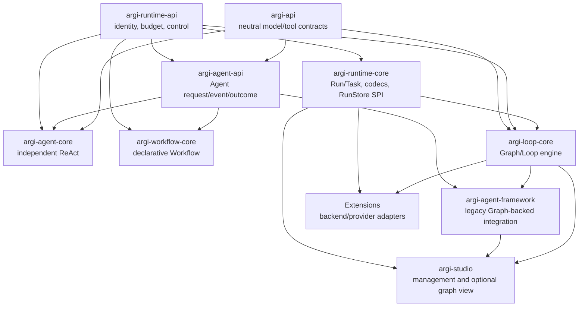

# ARGI Target Architecture

Status: adopted for the first independent execution plan. Reviewed 2026-10-24.

This document is the architecture deliverable for
[#186](https://github.com/agentic-ai-java/argi/issues/186). It defines the
product boundaries and the replacement sequence; it does not claim that all
future execution services or integrations already exist.

## Product scope

ARGI provides independently consumable Java building blocks for four related
but distinct concerns:

1. **Agent execution**: a model/tool turn with explicit identity, budget,
   cancellation and outcome semantics.
2. **Workflow execution**: a versioned declarative definition that composes
   agents, tools, conditions, bounded loops and bounded parallel branches.
3. **Loop execution**: a resumable graph engine with topology, state merge,
   checkpoints and graph recovery.
4. **Runtime management**: definition references, Run/Task identity, durable
   commit contracts, events and capability admission.

Persistence adapters, provider SDKs, Studio and remote protocols are optional
integrations. They consume the contracts above; they do not define them.

### Non-goals

- A universal state map shared by Agent, Workflow and Loop.
- A hidden Graph delegate behind the independent Agent or Workflow APIs.
- An arbitrary Java/script execution language in declarative definitions.
- A mandatory plugin marketplace, hot JAR loader or distributed scheduler in
  the first independent execution release.
- A claim of source-origin independence. Existing source and copyright history
  remain recorded; this plan addresses dependency and contract independence.

## Behavioral boundaries

| Boundary | Owns | Must not own |
| --- | --- | --- |
| `argi-api` | Neutral messages, model, tool and usage contracts | Execution state, provider SDKs, persistence |
| `argi-runtime-api` | Trusted identity, budget, delegation, cancellation and definition references | JSON codecs, engines, storage drivers |
| `argi-runtime-core` | Run/Task records, versioned payloads, admission, resolver and RunStore SPI | Graph topology, model calls, provider adapters |
| `argi-agent-api` | One invocation contract, request, event and outcome | Graph state, checkpoints, scheduler |
| `argi-agent-core` | Independent ReAct turn loop and tool/model coordination | Loop classes, Graph persistence, Spring context |
| `argi-workflow-core` | Declarative definition, validation, registry and direct execution | Loop as a required backend |
| `argi-loop-core` | Graph topology, compile/execute, state, checkpoint and graph recovery | Agent definition registry, vendor drivers, Studio controllers |
| `argi-agent-framework` | Transitional Graph-backed agents and framework integrations | The independent Agent/Workflow implementation contracts |
| `argi-studio` | Definition/run management UI and optional Loop graph view | Direct mutation of `CompiledGraph` as its management API |
| Extensions | Durable backend adapters, provider integrations and optional starters | A second copy of Core contracts or neutral execution engines |

The stable distinction is **engine state** versus **business data**. Agent
requests and outcomes are not implicit checkpoints. A Loop checkpoint is a
resumable graph boundary. A Run payload is versioned application data. A
Workflow state is owned by its executor and maps to a result; it is not
silently serialized as Loop state.

## Dependency direction



The graph shows allowed compile-time direction, not an obligation to include
every dependency in every application. In particular, an Agent-only consumer
can use `argi-agent-api` and `argi-agent-core` without Loop, and a Workflow
consumer can use `argi-workflow-core` without Loop.

## Public API shape

The independent invocation boundary is intentionally small:

```java
Agent agent = ReActAgent.builder(chatClient)
        .tools(new ToolRegistry(List.of(searchTool)))
        .build();

try (AgentExecutionContext context = AgentExecutionContext.builder(trustedContext).build()) {
    AgentOutcome outcome = agent.invoke(
            AgentRequest.messages(List.of(ChatMessage.user("Find the latest order status"))),
            context)
        .get();
}
```

The public concepts have one owner:

| Concept | Contract | Invariant |
| --- | --- | --- |
| Agent definition | `DefinitionReference` plus a published definition record | A published version is immutable and addressable by kind, id and version |
| Invocation | `Agent`, `AgentRequest`, `AgentEvent`, `AgentOutcome` | One invocation has one terminal outcome or one explicit suspension |
| Runtime identity | `TrustedExecutionContext` | Ordinary input maps and model metadata cannot create trusted identity |
| Limits | `ExecutionBudget`, `ExecutionControl` | Executors check control before and after side effects |
| Run | `RunSpec`, `RunState`, `RunStore` | Commit validates namespace, revision and fencing ownership |
| Loop state | `OverAllState`, `Checkpoint`, `BaseCheckpointSaver` | State merge and checkpoint history remain Loop semantics |
| Tool | `ToolCallback`, `ToolRegistry` and authorization policy | Authorization happens at the execution boundary, not in model text |
| Model | `ChatClient` adapter contract | Provider SDKs stay in adapters and Extensions |
| Studio | Management service and event DTOs | UI operations address a definition and run version, not a mutable graph object |

Definition publication, validation and instantiation are shared management
responsibilities. The concrete Workflow DSL remains Workflow-owned; Loop graph
topology remains Loop-owned. A future definition factory must resolve a
published definition into the neutral `Agent` contract rather than registering
arbitrary Java objects in a user-facing registry.

## Minimal definition-to-run example

The following is the target application shape. It is a contract example, not a
claim that the complete definition factory has already shipped in #199.

```java
DefinitionReference reference = definitions.publish(
        AgentDefinition.builder("order-support", "1.2.0")
                .model(ModelReference.of("support-model", "2026-10-01"))
                .tools(List.of(ToolReference.of("order.read", "1")))
                .inputSchema("{\"type\":\"object\"}")
                .build());

Agent agent = definitions.createAgent(reference, authenticatedContext);
RunSpec run = runs.submit(RunRequest.forAgent(reference, input), authenticatedContext);
AgentOutcome outcome = agent.invoke(request, authenticatedContext).get();
runs.commit(run, outcome);
```

The actual factory must reject unknown model/tool versions and unsupported
parameters before a model or tool side effect. In-flight runs keep the exact
definition and capability versions selected at admission. Updating the latest
version affects new runs only.

## Decisions and alternatives

| Decision | Evidence | Alternatives | Result |
| --- | --- | --- | --- |
| Keep `StateGraph`/`CompiledGraph` names inside Loop | The types describe topology and are present in checkpoint and observation contracts | Rename all packages; add wrappers; retain names | Retain FQCNs until a data-safe migration proves a behavior benefit |
| Make Agent and Workflow independent | Existing implementations now compile without Loop and have independent behavior tests | Keep Graph delegate; put a renamed facade over Graph | Rejected because wrappers preserve the coupling without a new contract |
| Keep Runtime API JDK-only | Identity and control are consumed by independent engines | Put runtime types in API or Loop | Rejected because it either couples model adapters or makes Loop a shared monolith |
| Version definitions and capabilities | Recovery already requires exact version selection | Mutable latest definition; class-only registration | Rejected because in-flight and recovered runs become ambiguous |
| Separate Run payload from Loop checkpoint | They have different ownership and compatibility rules | Serialize every Run as graph state | Rejected because it leaks graph semantics into Agent and Workflow consumers |
| Keep provider integrations optional | Core production bytecode must be provider-neutral | Add provider SDKs to Core | Rejected because it prevents independent adapters and increases transitive surface |

Every breaking decision is limited to a concrete boundary. Artifact replacement
from `argi-graph-core` to `argi-loop-core` was adopted in #198 because the old
coordinate prevented an independent Loop product boundary. Package names and
wire literals remain unchanged where renaming would add migration risk without
removing a dependency.

## Replacement sequence

| Phase | Deliverable | Entry condition | Exit/removal condition |
| --- | --- | --- | --- |
| 0 | Neutral API and compatibility baseline | #181/#182/#183/#184/#185 | Fixtures and dependency gates are reproducible |
| 1 | Agent API, independent ReAct and Workflow | #195/#196/#197 | Standalone consumers execute without Loop; behavior tests cover cancellation, tools and outcomes |
| 2 | Loop artifact and runtime extraction | #198/#200 | Loop consumers use `argi-loop-core`; Runtime API/Core owns neutral Run contracts |
| 3 | Definition publication and factory | #199 | Publish/query/version conflict and unsupported capability tests pass; no Java rebuild for a new definition |
| 4 | Capability packages and policy diagnostics | #201/#202/#203 | Effective capability snapshot, scope and rollback tests pass |
| 5 | Studio management boundary | #204 | Studio creates and queries definition-bound runs without direct graph mutation |
| 6 | Durable execution and backend ownership | #124/#190/#235/#236 | Backend contract tests pass with restart, fencing and real storage evidence |

The old Graph-backed Agent Framework remains during the transition. Its removal
requires all supported consumers to use the neutral Agent contract, a published
replacement for each supported hook, and a release with an explicit migration
note. No compatibility layer is added merely to make an old engine look
independent. Rollback is by reverting the matching Core/BOM/Extensions release;
durable data follows the matrix in
[`checkpoint-compatibility.md`](checkpoint-compatibility.md).

## Technical independence acceptance

Each independent artifact must satisfy all of the following before it is called
complete:

- public signatures contain no `StateGraph`, `CompiledGraph`, `RunnableConfig`,
  provider SDK or Studio type unless the artifact is explicitly an integration;
- bytecode dependency checks confirm the intended graph/provider boundary;
- a clean consumer can compile and run using only the intended artifact set;
- behavior tests cover normal completion, tool failure, cancellation, deadline,
  suspension/resume and version pinning where the capability supports them;
- durable implementations prove restart persistence, fencing and rollback using
  their actual backend, not only an in-memory double;
- historical checkpoint and Run payload fixtures continue to round-trip under
  the compatibility contract.

This is technical architecture independence. It intentionally does not assert
that the repository has a clean-room source history.
